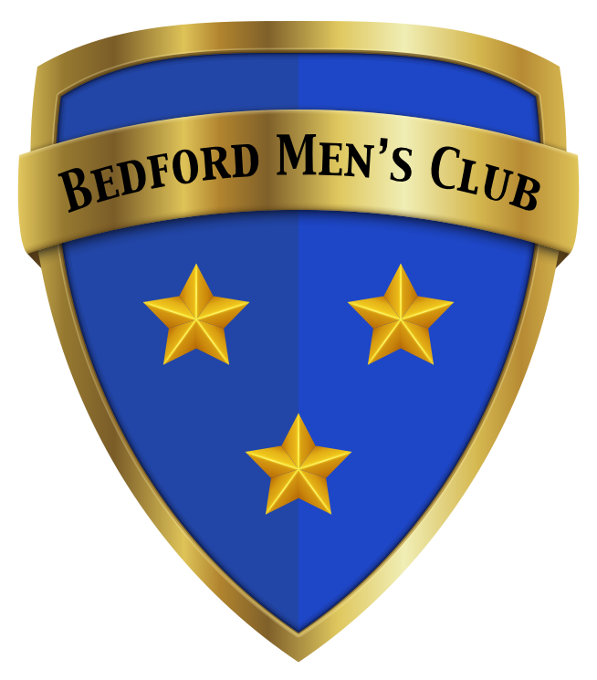

  

# Bedford Men's Club

Brand assets, vector graphics, legacy imagery, and LaTeX source files for Bedford Men's Club (Bedford, NH) promotional flyers and print materials.

## Repository Structure

| Path | Description |
| :--- | :--- |
| `.gitignore` | Ignores `build/`, `svg-inkscape/`, LaTeX auxiliary files, and OS temporary files |
| `Makefile` | Automates QR code generation, SVG conversion, and LaTeX flyer compilation |
| `assets/logos/bmc-v1.svg` – `bmc-v3.svg` | Earlier vector iterations of the Bedford Men's Club shield logo |
| `assets/logos/bmc-v4.svg` | Current vector logo (recommended for all new print and digital materials) |
| `assets/illustrations/christmas_tree.svg` | Vector Christmas tree illustration used in seasonal flyers |
| `assets/legacy/BMC_ImageHuge.jpg` | High-resolution legacy raster image |
| `assets/legacy/BMC_shield_2019.jpg` | Legacy 2019 shield emblem raster image |
| `flyers/tree-sale-2026.tex` | LaTeX source for the 2026 Annual Christmas Tree Sale flyer |

## Assets Overview

- **Vector Logos (`assets/logos/`)**: Scalable SVG versions of the Bedford Men's Club shield across revisions (`bmc-v1.svg` through `bmc-v4.svg`). Use `bmc-v4.svg` for new print and digital designs unless a historical variant is specifically needed.
- **Illustrations (`assets/illustrations/`)**: Reusable vector artwork for club events and seasonal publications, such as `christmas_tree.svg`.
- **Legacy Assets (`assets/legacy/`)**: Archived high-resolution `.jpg` files retained for reference and backward compatibility.

## Building Flyers

Promotional flyers in `flyers/` are authored in LaTeX (`.tex`) and compiled into `build/` using the root `Makefile`.

### Prerequisites

- `make`
- TeX Live (or another TeX distribution) providing `pdflatex` with `-shell-escape` support
- `inkscape` (required by LaTeX's `svg` package to export SVGs to PDF/LaTeX)
- `qrencode` (generates QR codes for the club website and Facebook page during the build)

### Build Targets

Run `make` from the repository root to check dependencies and compile all flyers into `build/`:

    make

Additional targets defined in the `Makefile`:

- `make clean` — Remove intermediate LaTeX and `svg-inkscape` build files
- `make distclean` — Remove all intermediate files and compiled PDFs in `build/`
- `make help` — Display available targets and descriptions